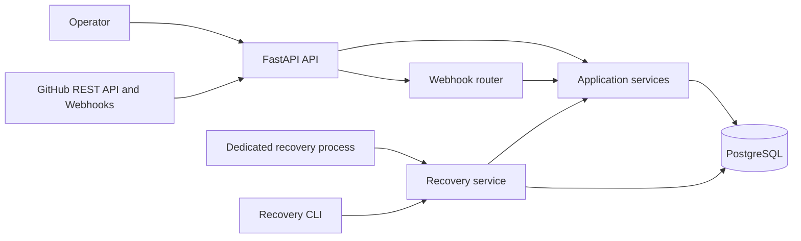
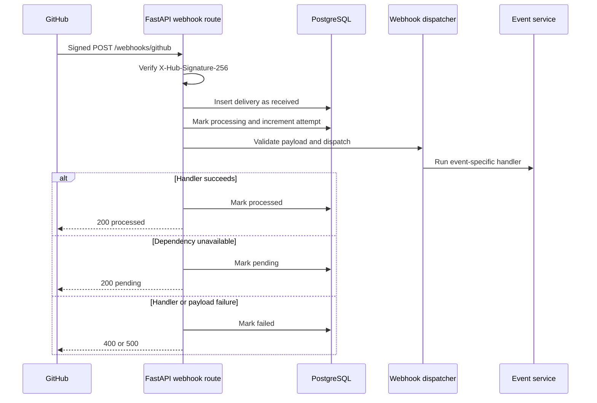
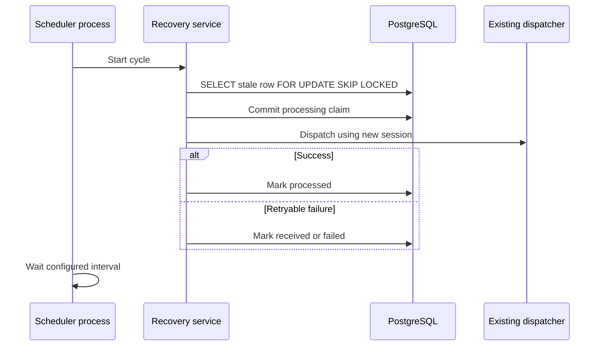

# Architecture

## System context

PR Outcome Engine receives GitHub pull-request evidence through REST synchronization
and signed GitHub webhooks. It persists repositories, pull requests, commits,
changed files, reviews, checks, feature snapshots, outcomes, and risk
assessments in PostgreSQL.

The root Compose file provides PostgreSQL and pgAdmin for local development;
it does not run the backend or define a production ingress boundary.

## API and service architecture

`app.main` creates the FastAPI application and includes the API, ML, health,
and webhook routers. Business routers use shared bearer-token dependencies.
Application services coordinate persistence and GitHub access. SQLAlchemy
sessions are created per request by `app.db.session.get_db`.

The webhook dispatcher selects an event-specific service for `pull_request`,
`pull_request_review`, `check_run`, and `push` events. Unsupported event types
are logged and ignored after their delivery record is persisted.

## Database responsibilities

Alembic owns the schema. PostgreSQL stores durable domain records and the
`webhook_event` delivery record. `delivery_id` is unique. Webhook recovery
metadata includes attempt count and attempt/error timestamps. PostgreSQL row
locking with `FOR UPDATE SKIP LOCKED` is used when recovery claims stale
events.

The repository does not create, drop, or reset databases automatically for
integration tests. A dedicated PostgreSQL database URL is required.

## Pull-request ingestion flow

Operator imports or refreshes repositories and pull requests through protected
admin routes. Synchronization services import commits, changed files, reviews,
and checks. Feature snapshots are created only when the required source data
is present. Outcome evaluation uses persisted evidence and current-head check
results.

## Webhook lifecycle

The delivery record is inserted before dispatch. A processed duplicate is
acknowledged without dispatch. Received, processing, pending, and failed
duplicates return their persisted state without a second HTTP dispatch.

## Pending review replay

When a review arrives before its pull request exists, the review event becomes
`pending`. `WebhookRetryService` replays matching pending review events during
pull-request lifecycle processing after the pull request and related evidence
are synchronized. Pending events are not included in stale recovery.

## Recovery and retry architecture

The recovery service considers only stale `received` and `processing` events
for supported event types. It excludes `pending`, `processed`, and exhausted
events. It claims one row in a short transaction, commits the claim, closes
that session, and dispatches using a separate session. Handler failures return
the event to `received` until the configured attempt limit, then set it to
`failed`.

## Dedicated scheduler process

Automatic recovery is not started by FastAPI application startup. The
`scripts/run_webhook_recovery.py` entry point runs one recovery cycle
immediately and repeats at the configured interval. It is disabled unless
`WEBHOOK_RECOVERY_ENABLED=true`. Exactly one process is intended per
deployment. Multiple processes rely on PostgreSQL row claims to avoid
dispatching the same row, but live distributed PostgreSQL verification is
still outstanding.

The existing `scripts/recover_webhooks.py` command remains operator-controlled
and dry-run by default.

## Authentication boundaries

Business and data routes require a bearer token. The read token permits
read-only routes; the admin token permits read access and administrative
mutations. The webhook route does not use bearer authentication: it verifies
GitHub's HMAC signature using `GITHUB_WEBHOOK_SECRET`. Health, readiness, root,
and API documentation routes are public.

## Health and readiness

`GET /health` is a liveness response and does not query the database.
`GET /ready` executes `SELECT 1` and returns HTTP 503 when the database is
unavailable. Neither endpoint exposes credentials or database connection
details.

## Verification boundary

Local unit and simulated recovery tests pass. PostgreSQL integration tests are
prepared for migration, independent-session, duplicate-insertion, and
`SKIP LOCKED` behavior, but they require a live dedicated PostgreSQL database
and remain unverified in the current environment.
